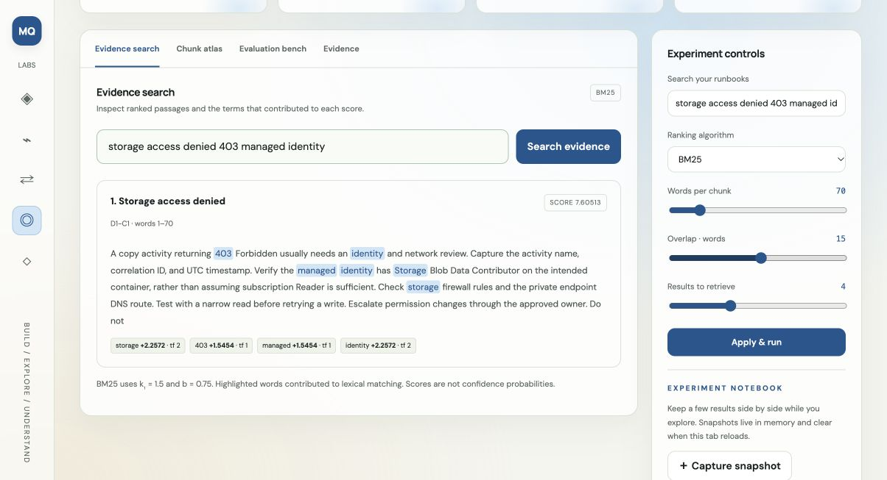
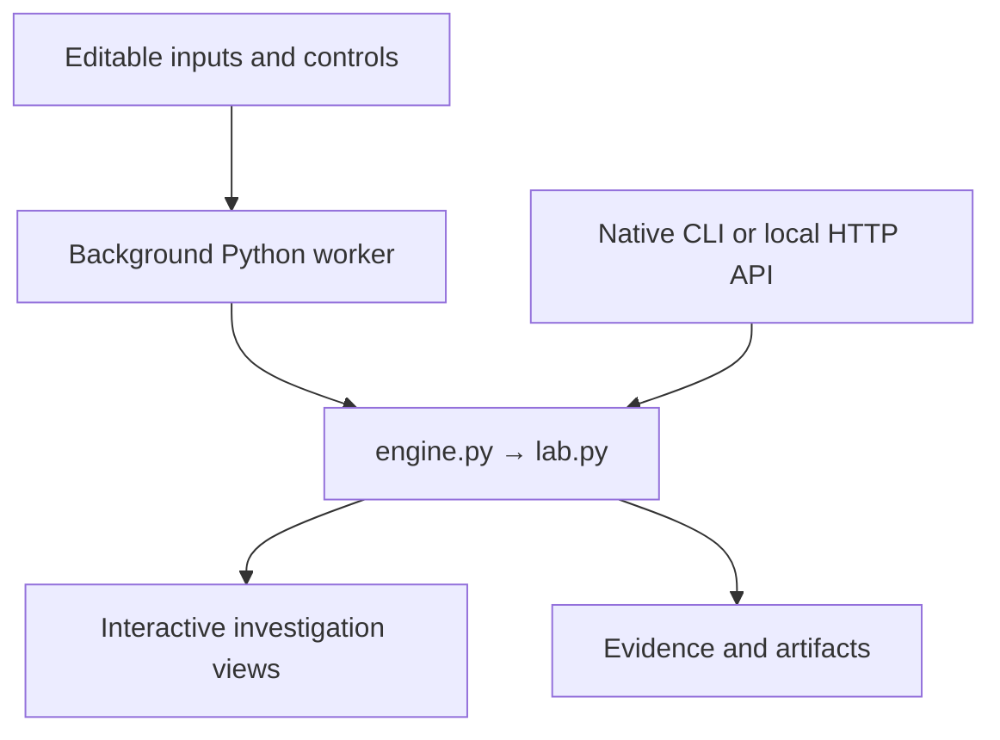

<p align="center"><a href="https://m-qazi99.github.io/runbook-radar/"></a></p>
<p align="center"><a href="https://m-qazi99.github.io/runbook-radar/"><strong>Launch the interactive studio ↗</strong></a> · <a href="#run-locally">Run Python locally</a> · <a href="docs/ARCHITECTURE.md">Architecture</a> · <a href="tests/test_studio.py">Tests</a></p>
<p align="center">  </p>

# Runbook Radar Studio

**Make retrieval experiments explainable.**

Explore how search actually works. Compare BM25 and TF-IDF, inspect term contributions, and evaluate retrieval against labeled questions.

<p align="center"><a href="https://m-qazi99.github.io/runbook-radar/"></a></p>

## Explore the product

Search a storage incident → inspect highlighted terms and score contributions → explore **Chunk atlas** → change chunk size → compare **Evaluation bench** → try **No evidence**.

| Capability | What you can inspect |
|---|---|
| BM25 versus TF-IDF ranking | Python-computed results, accessible controls, and exportable evidence |
| Per-term score explanation | Python-computed results, accessible controls, and exportable evidence |
| Controllable chunk atlas | Python-computed results, accessible controls, and exportable evidence |
| Labeled MRR and hit-rate evaluation | Python-computed results, accessible controls, and exportable evidence |

The interface includes three synthetic scenarios, four workspace views, light multicolor themes, editable inputs, local file loading, in-memory experiment snapshots, keyboard shortcuts, and downloadable artifacts. The **input editor** exposes the real experiment rather than hiding the model behind a decorative dashboard.

## Python mechanics

Markdown headings delimit documents. Adjustable word windows and overlap create source-cited chunks. BM25 (k₁=1.5, b=0.75) and log TF-IDF cosine similarity rank the same collection. Per-term score contributions expose the ranking. Labeled questions produce mean reciprocal rank and Hit@K for each algorithm.

## Run locally

No Python packages are required. Use Python 3.11 or newer.

```bash
git clone https://github.com/m-qazi99/runbook-radar.git
cd runbook-radar
python server.py
```

Open **http://127.0.0.1:8000**. The local server exposes the native Python API; the web UI uses the browser worker so its behavior matches the public demo. The public site requires a modern browser with WebAssembly and access to the runtime CDN.

```bash
# Native Python CLI: no browser, CDN, or third-party packages
python src/cli.py < examples/studio.json

# Native Python HTTP API
curl -s http://127.0.0.1:8000/api/analyze \
  -H 'Content-Type: application/json' \
  --data-binary @examples/studio.json

# Engine, boundary, and regression tests
python -m unittest discover -s tests -v
python scripts/check_site.py

# Regenerate the labeled synthetic first-visit preview
python scripts/build_preview.py
```

`examples/studio.json` is the complete version-2 experiment request. The `workspace: "studio"` field selects the advanced engine in `src/lab.py`. The original version-1 API remains available through `examples/sample.json` for compatibility. Errors return HTTP 400 with an `error` message; successful requests return metrics, evidence, artifacts, and a structured `lab` object for visualization.

## Architecture



- `src/lab.py` — the advanced, dependency-free Python computation.
- `src/engine.py` — explicit version routing and original API compatibility.
- `docs/lab.py`, `docs/engine.py`, `docs/common.py` — byte-identical browser copies, checked by CI.
- `docs/studio.js` — rendering, interaction, worker lifecycle; no duplicate analytical algorithm.
- `docs/worker.js` — pinned Pyodide 0.27.7 runtime in a Web Worker.
- `tests/` — **22 automated tests**, including scenario boundaries and regressions.
- `.github/workflows/tests.yml` — tests and browser/native source parity on each push.

## Scope and limitations

Lexical search is not a generative assistant. It has no LLM, embeddings, or external API. Scores are not calibrated confidence. MRR uses the first chunk from the expected document; a tiny synthetic evaluation set is not a benchmark claim.

Inputs remain in the active tab. Initial runtime files come from jsDelivr and fonts from Google Fonts; no input is sent to these services. Inputs and snapshots are not automatically persisted. Exported experiments include their input; review before sharing. File contents are limited to 2 MB and CSV datasets to 10,000 rows.

## Design and research

This studio is an independent implementation by **Muzammil Qazi**, developed with Codex assistance as a portfolio engineering project. Synthetic scenarios demonstrate the algorithms; they are not employer deliverables or evidence of production adoption. See [design decisions](docs/ARCHITECTURE.md) and [research references](docs/RESEARCH.md).

[Portfolio](https://m-qazi99.github.io/) · [GitHub](https://github.com/m-qazi99) · [MIT](LICENSE)
